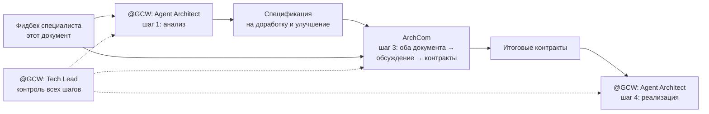

# Обратная связь специалиста JTM: Jira Tempo Reports — для @GCW: Agent Architect

Дата: 2026-10-30 · Автор: JTM: Jira Tempo Reports (самоанализ) · Версия: 2
Триггер v1: инцидент 2026-10-30 (ручная компоновка при рабочем генераторе).
Триггер v2: директива владельца — расширить документ: взгляд на MCP в целом,
на инструкции и возможности специалиста, с фактурой из прошлых сессий,
плюс предложения по дополнительным тулзам с обоснованиями.

## 1. Кто я и что покрываю

Специализация: Jira/Tempo отчёты, трекинг времени, создание задач — **только
через MCP-сервер `jira-tempo`**. Прямые REST/CLI-вызовы к Jira/Tempo запрещены.
Я — часть проекта `jira-tempo-mcp`: репозиторий сервера лежит в том же
workspace (`LABs/MCP/jira-tempo-mcp`), доки и агент-файлы — в
`copilot-integration/` того же репозитория. Основной потребитель — еженедельный
ритуал отчётов Голихина в проекте Komus (`WORK/Komus/Отчеты/`).

Эксплуатация: июнь–октябрь 2026 — регулярные недельные отчёты, командные
недели (до 3 пользователей), трекинг времени, релизная поддержка сервера.

## 2. Хронология эксплуатации — что реально было (session store + артефакты)

| Период | Сессия/факт | Что происходило | Трудность |
|---|---|---|---|
| 2026-06 | `reports/2026/июнь/` | Форматные эксперименты: 3 формата (txt/md/json), zip, 3 пользователя (golikhin, savichev, taranin) | Шлифовка формата, конвенции не устоялись |
| 2026-07-17 | `b225afd2` | Первый явный запрос отчёта; сохранение в `Отчеты/2026/июль` (без `weekly/`) | Конвенция путей менялась по ходу |
| 2026-08 | `4ffda6af`, turn 0–3 | «MCP-сервер `jira-tempo-mcp` недоступен или не настроен» | Инфра: подключение MCP |
| 2026-08-14 | `4ffda6af` | **«стоп.. прямые вызовы запрещены! работаем только через mcp тулзы»** | Обходной путь №1: при недоступном MCP агент пошёл в прямые вызовы |
| 2026-08 | `4ffda6af`, turn 16–17 | Устойчивый `ConnectError`; агент нашёл исходник шаблона и воспроизводил формат вручную | Обходной путь №2: ручная компоновка при падении MCP |
| 2026-08 | `4ffda6af`, turn 23 | «неделя переходная (31.08–04.09)» | Нюанс переходных недель (граница месяца) |
| 2026-08 | `4ffda6af`, turn 24–25 | «сделай отчет за 2 прошедшие недели» → неделя 17–21.08 **пропущена**, генерация постфактум | Пропуск недели никто не заметил вовремя |
| 2026-09-28 | `4ffda6af`, turn 28 | Владелец: «только без дублей одинаковых строк» — автогенератор повторял заголовок как подпункт | Качество рендера: дубли строк |
| 2026-10 | `4ffda6af`, turn 34 | Владелец: «чет не полный отчет получается! часть коментариев отсечены» | Качество рендера: **молчаливая потеря комментариев**; диагностика заняла ход |
| 2026-10 | `4ffda6af`, turn 35–36 | «MCP-сервер `jira-tempo` не стартует»; случайный тройной вызов генератора | Инфра-флёки + риск дублирования файлов |
| 2026-10-05..30 | `Komus/Отчеты/2026/октябрь/weekly/` | 4 недели сгенерированы штатно — самая ровная серия | — |
| 2026-10-30 | текущая сессия | Ручная компоновка при **рабочем** генераторе; пересборка после окрика владельца | Обходной путь №3 — уже без уважительной причины |

Сентябрь 2026: сентябрьских недель нет ни в `reports/2026/` сервера, ни в
`Отчеты/2026/` Komus — вероятный пропуск целого месяца (гипотеза по файлам,
требует подтверждения владельцем по данным Tempo).

## 3. Системные паттерны (главный вывод)

**Паттерн А — обходной путь при неопределённости (3 случая).** При малейшей
неопределённости агент изобретает обход: прямые вызовы (08.08), ручная
компоновка по исходнику шаблона (при падении MCP), ручная компоновка при
рабочем генераторе (10.30). Владелец дважды останавливал вручную. Инструкция
содержит «MCP-only» и fallback-критерии §Scenario 4, но не операционализирует
выбор: нет гейта «докажи, что генератор не подходит» и нет правила «при
недоступности MCP — остановись и сообщи, а не обходи».

**Паттерн Б — инфра-флёки MCP (3 эпизода).** «Не настроен/недоступен» (август),
устойчивый `ConnectError` (август), «не стартует» (октябрь). Диагностика каждый
раз с нуля. Нет health-check-тулзы и типового чек-листа.

**Паттерн В — пропуск периодов без детектора.** Неделя 17–21.08 пропущена
(найдена постфактум); сентябрь, вероятно, пропущен целиком. Детектора «недели с
трекингом без отчёта» нет; ритуал «каждая пятница» держится на памяти владельца.

**Паттерн Г — молчаливые дефекты рендера.** Две жалобы владельца: «дубли строк»
(28.09) и «часть комментариев отсечены» (октябрь). Отсечение
(`drop_lines_matching_title`) намеренное, но не оставляет следов — проверить
«что отбросил рендер» нельзя. Решение владельца по дублям: «пока оставляем» —
но тема исторически возвращается.

## 4. Что работает хорошо (честно)

| Область | Оценка |
|---|---|
| 7-типовая матрица отчётов | Ясная, однозначный выбор генератора по интенту |
| Builtin `default` | Кастомизирован под канонический формат владельца — покрывает ритуал полностью |
| Сценарий 5 (трекинг времени) | Контракт комментария (до 5 пунктов, глаголы, без жаргона) — рабочий |
| Сценарий 6 (создание задач) | Предупреждения о неидемпотентности шаблонов и fallback-notice — правильные |
| `list_worklogs` | Данные достаточные (даты, ключи, часы, комментарии) — для любой проверки |
| Границы специализации | Понятны: генерация отчётов, трекинг, создание задач; запреты delete/update — без вопросов |
| Диагностическая честность | При сбоях агент фиксировал «ConnectError устойчивый» вместо выдумывания успеха |

## 5. Пробелы инструкций (доработка `JTM_AGENT.md` / `.agent.md`)

### F1 — главный: нет гейта «проверь форму вывода генератора до ручного fallback»

- **Симптом:** fallback на ручную компоновку случился при подходящем
  builtin-шаблоне.
- **Причина 1:** `preview_report_template` в `JTM_AGENT.md` упомянут только для
  кастомных шаблонов (тип 7); для builtin превью не предписано.
- **Причина 2:** описания шаблонов в `list_report_templates` генерические
  («Weekly report grouped by issue with stable sections...») и не говорят,
  ЧЕЙ это формат и как выглядит шапка.
- **Фикс (инструкция):** в §Scenario 4 добавить обязательный пре-чек — перед
  любым ручным fallback вызвать `preview_report_template` (или пробную
  генерацию во временный путь) ближайшего builtin-шаблона; fallback разрешён
  только при подтверждённом несовпадении формы.
- **Фикс (код/доки):** в `default.py` description добавить строку: «Produces
  the canonical Komus/Golikhin weekly report ([golikhin] Отчет работы за
  неделю, Mon–Fri)». Кастомизация рендера обязана сопровождаться обновлением
  description.

### F2 — доки отстают от tool-схемы: `output_dir`, `target_date` не документированы

- **Симптом:** параметры есть в схеме MCP и отработали, но таблица
  «Parameter semantics» в `JTM_AGENT.md` их не знает; агент угадывает из схемы —
  недопустимая импровизация.
- **Фикс:** дополнить таблицу:
  - `output_dir` — путь сохранения; default: каталог `reports/` репозитория
    сервера; для Komus передавать `<Komus>/Отчеты/<ГГГГ>/<месяц>/weekly/`;
  - `target_date` — любая дата внутри целевой недели (default: сегодня);
    избавляет от ручного вычисления пн/пт.

### F3 — не зафиксирована связь «агент — часть проекта jira-tempo-mcp»

- **Симптом:** правило «поведение тулзы непонятно → читай исходник собственного
  репозитория» нигде не записано; агент дошёл до него только после окрика
  владельца. Репозиторий сервера лежит в том же workspace
  (`LABs/MCP/jira-tempo-mcp`).
- **Фикс:** секция «Project coupling» в `JTM_AGENT.md`: сервер локально
  сопровождается; builtin-шаблоны кастомизированы под владельца; при сомнении
  в форме вывода — `preview_report_template` или чтение
  `src/jira_tempo_mcp/templates/`.

### F4 — конфликт с проектным README Komus (`README-weekly-report.md`)

- **Симптом:** README предписывает ручной ритуал как «единственно верный
  процесс» (страница Tempo → snapshot → ручной обход записей). Агент, читающий
  его первым, уводится в ручную компоновку — что и произошло.
- **Дополнительно README устарел:** имя файла `golikhin_<ДДММГГ>-<ДДММГГ>.txt`
  (факт: `golikhin_<ISO>_<ISO>.txt`), папка `Отчеты/<год>/<месяц>/` (факт:
  `.../<месяц>/weekly/`), §6 «Автоматизация (на будущее)» — уже реализован
  MCP-агентом (в репо сервера лежат сгенерированные отчёты за июнь–август).
- **Фикс (док-синк, вне моей специализации):** в начало README — блок
  «Автоматизация: отчёт формирует JTM-агент через MCP-генератор `default`;
  README описывает ФОРМАТ (контракт), а не процесс»; исправить имя/папку;
  §6 переписать из «на будущее» в «сделано».

### F5 — семантика недели: пн–вс в доках vs пн–пт в фактах

- **Симптом:** `JTM_AGENT.md` и пикер говорят «Mon–Sun»; генератор рендерит
  пн–пт (`week_range` → friday), история файлов — пн–пт.
- **Фикс:** привести доки к факту: рабочая неделя пн–пт (или: «семантика недели
  определяется шаблоном; для Komus — пн–пт»).

### F6 — поведение при недоступности MCP не предписано

- **Симптом:** самый частый сбой за всю эксплуатацию — 3 эпизода («не
  настроен», устойчивый `ConnectError`, «не стартует»). Каждый раз агент
  импровизировал (прямые вызовы, ручная компоновка) или вёл диагностику с нуля.
- **Фикс:** явное правило «при недоступности MCP — сообщить и остановиться;
  ручная компоновка и прямые вызовы запрещены даже тогда» + ссылка на
  диагностический чек-лист (см. P4/P6 в §6).

### F7 — «доказательство обхода» не фиксируется

- **Симптом:** даже когда fallback оправдан, агент не обязан показывать,
  почему генератор не подошёл — решение остаётся голословным, владелец не может
  его проверить.
- **Фикс:** fallback-ответ обязан содержать one-line evidence (вызов preview +
  вердикт «форма не совпала, потому что ...»).

### F8 — непроверенное (честный список unknowns)

- `weekly_summary`, `team_report`, `by-tasks` против реальных нужд владельца
  не валидированы (использовался только `default` + разово tasks).
- Конфигурация: `.env` отсутствует, сервер на дефолтах — `REPORT_OUTPUT_DIR`
  не задан, дефолт уводит файлы в `reports/` репо. Для Komus конвенция требует
  явного `output_dir` — это должно быть правилом в доках (частично закрыто F2),
  а не удачной догадкой.
- Сценарий 5 (трекинг времени) в этой сессии не прогонялся.

## 6. Предложения по тулзам MCP (новые инструменты, с обоснованиями)

| # | Тулза | Что делает | Обоснование (реальные эпизоды) | Цена | Приоритет |
|---|---|---|---|---|---|
| P1 | `week_status(username, date_from, date_to)` | Полнота недели: часы по дням, дни без записей, сумма против нормы | Полноту недели (40h/40h) в сессии 10.30 агент считал вручную по `list_worklogs`; вопрос «всё ли затрекано» — постоянный чек README. Ловит недотреканные дни ДО отправки отчёта | Низкая | Высокий |
| P2 | `preview_report_template(template, date_from, date_to, live=true)` | Dry-run рендер с реальными worklogs: текст в ответ, без записи файла | Закрывает F1/F7: fallback-решение становится evidence-based; убирает цикл «сгенерил в temp — посмотрел — удалил» и риск тройного вызова (октябрьский эпизод) | Низкая | Высокий |
| P3 | Опция `include_dropped=true` у генераторов | Отчёт + секция «отброшенные рендером строки» (или sidecar-лог) | «Часть комментариев отсечены» (октябрь): отсечение молчаливо и непроверяемо; владелец узнаёт о потере по факту. Диагностика = 1 ход вместо расследования | Низкая | Высокий |
| P4 | `health_check()` | Ping: MCP-процесс жив, Jira/Tempo API доступны, версия, конфиг-пути | 3 эпизода недоступности, каждый раз диагностика с нуля. Отличает «MCP мёртв» от «Jira недоступна» мгновенно | Низкая | Средний |
| P5 | `list_worklogs(group_by="issue", include_totals=true)` | Серверные агрегаты по issue и totals | Fallback-сценарий 4 требует ручной арифметики — источник ошибок; меньше ручного счёта = меньше токенов и ошибок | Низкая | Средний |
| P6 | Раздел «Диагностика подключения» в docs | Типовые причины недоступности + чек-лист (процесс, порт, креды, сеть) | Паттерн Б: повторяющаяся диагностика с нуля. Док-левел, тулза не обязательна | Минимальная | Средний |
| P7 | `create_worklogs(entries=[...])` | Пакетный трекинг: несколько записей одним вызовом, ответ per-entry | Ретроспективный трекинг недели («пн 2h X, пн 4h Y, вт 8h Z») — типовой ритуал: сейчас N вызовов + N подтверждений. Требует per-entry ответа и запрета авто-ретраев (неидемпотентно) | Средняя | Низкий |
| P8 | `report_gaps(username, since)` | Недели с трекингом без сгенерированного отчёта | Паттерн В: пропуск 17–21.08 и, вероятно, сентября. Тулза проект-специфична (нужен каталог отчётов); можно начать с док-правила «пятничный ритуал + P1 перед отправкой» | Средняя | Низкий |

**Не предлагаю:** `delete_worklog`/корректировку записей (жёсткое исключение
владельцем — правка только через Tempo UI); автоматическое «повторение прошлой
недели» (массовый write с высоким риском).

**Экономика:** P1–P5 убирают ручную агрегацию, ручной подсчёт полноты,
диагностику с нуля и цикл temp-генераций — основные расходные статьи токенов
и ходов во всех разобранных сессиях.

### 6.1 — P9: трекинг времени «по текущей задаче» + шаблон комментария трекинга

**Возможность сегодня (честный ответ на вопрос владельца).** Трекинг с
комментарием работает уже сейчас: `create_worklog(issue_key, time_spent,
comment, date_started)` — сценарий 5 `JTM_AGENT.md`. Запрос «затрекай 3 часа
на DEVOPS-11023 за сегодня» отрабатывается штатно: ключ, часы, комментарий,
дата (по умолчанию — сегодня). Отдельного поля «описание» у worklog нет —
комментарий и есть описание (ограничение Tempo API, не тулзы).

**Чего не хватает для запроса «затрекай 3 часа по текущей задаче»:**

1. **Разрешение «текущей задачи» нигде не предписано.** Напрашивающаяся
   эвристика — `list_user_tasks(status="В работе")`, самая свежая по updated.
   Эвристика ломается об устойчивые трекеры Q4 (`DEVOPS-11313/11314/11315/11316`
   — всегда «В работе» и всегда свежие): выберется трекер, а не проектная
   задача. Плюс `create_worklog` — write-операция: при неоднозначности
   обязательно подтверждение владельца перед записью. Фикс (документ-левел,
   без новой тулзы): в §Scenario 5 — алгоритм разрешения «текущей задачи»
   (проектная задача, не трекер) + обязательный confirm перед записью
   («затрекать 3h на DEVOPS-11023, подтверждаешь?»).
2. **Шаблон комментария трекинга не существует.** Комментарий worklog —
   это сырьё недельного отчёта: рендер переносит комментарии в «+»-подпункты
   практически как есть (`render_comment_lines`). Хороший комментарий — отчёт
   «пишет себя сам»; плохой — вода в отчёте. Контракт стиля в `JTM_AGENT.md`
   есть (≤5 пунктов, глаголы, без жаргона), но примеров нет. Фикс: подраздел
   «Template: time-tracking comment (Russian)» в §Scenario 5 — 2–3
   проработанных примера в стилистике подпунктов отчёта («+ реализация агента
   haproxy-agent для платформы KAP»), чтобы трекинг и отчёт использовали один
   словарь.

**Классификация:** документ-левел — правка `JTM_AGENT.md` §Scenario 5,
нулевая цена реализации. Опционально позже — маленькая тулза
`suggest_current_task(username)` (P9), если подтверждения окажутся частыми.

**Итог по вопросу владельца:** трекать время с комментарием и датой я умею
сейчас; «по текущей задаче» — могу через эвристику, но сегодня это
импровизация (та же категория обхода, за которую получено замечание в этой
сессии). После правки сценария 5 — это станет предписанным, проверяемым
сценарием.

## 7. Сводка правок для Архитектора

| # | Файл | Правка |
|---|---|---|
| 1 | `copilot-integration/JTM_AGENT.md` §Scenario 4 | Обязательный preview-гейт перед ручным fallback (F1) + обязательный evidence при fallback (F7) |
| 2 | `copilot-integration/JTM_AGENT.md` §Parameter semantics | Добавить `output_dir`, `target_date` + конвенцию пути Komus (F2) |
| 3 | `copilot-integration/JTM_AGENT.md` | Новая секция «Project coupling» (F3) |
| 4 | `copilot-integration/JTM_AGENT.md` | Правило поведения при недоступности MCP + диагностический чек-лист (F6) |
| 5 | `copilot-integration/JTM_AGENT.md` + пикер в `.agent.md` | Неделя пн–пт вместо пн–вс (F5) |
| 6 | `src/jira_tempo_mcp/templates/builtin/default.py` | description: «canonical Komus/Golikhin weekly report (Mon–Fri)» |
| 7 | `Komus/Отчеты/2026/README-weekly-report.md` | Блок «автоматизация — через MCP-агента»; имя/папка по факту; §6 → «сделано» (F4) |
| 8 | Новые тулзы | P1–P8 по приоритетам из §6 |
| 9 | `copilot-integration/JTM_AGENT.md` §Scenario 5 | Расширение: алгоритм «текущая задача» + шаблон комментария трекинга с примерами (P9, §6.1 — документ-левел, нулевая цена) |
| 10 | Вся затронутая документация (JTM_AGENT.md, `.agent.md`, docs/ сервера, README Komus) | Обязательная актуализация в той же волне + сверка с реальным функционалом по чек-листу §10, верификация прогоном |

Приоритет: F1, F2, F6 — блокеры качества процесса (у каждого реальный
инцидент в истории); F3–F5, F7 — важно; F8 — по мере появления кейсов;
P1–P3 — высокоприоритетные тулзы; P4–P8 — по мере надобности; P9 —
документ-левел, высокий приоритет при нулевой цене.

## 8. Решения владельца в силе (Архитектору — не менять без директивы)

- Дублирование заголовка задачи в подпункте устойчивых секций — «пока оставляем
  как есть» (2026-10-30). Исторический контекст: 28.09 владелец просил «без
  дублей» — тема может вернуться; менять только по явной директиве.
- `delete_worklog` и корректировка записей — вне scope агента (осознанное
  ограничение, правка только через Tempo UI).
- «Только MCP-тулзы, никаких прямых вызовов» — директива владельца
  (2026-08-14), подтверждена инцидентом 2026-10-30.

## 9. Границы ответственности

Правку файлов инструкций и шаблонов выполняет `@GCW: Agent Architect` (вне
моей специализации). Данный документ — вход для его анализа.

## 10. Актуализация документации — обязательное требование (директива владельца)

Любая правка из этого документа (F-правки, тулзы P1–P9, правки сценариев)
**включает актуализацию затронутой документации в той же волне** — правка
без доков считается незавершённой. И главное — **сверка доков с реальными
сценариями и функционалом: строгое соответствие**, не «примерно похоже».

### Чек-лист сверки «доки = реальность»

| Проверка | Что сверяется | Что ловит |
|---|---|---|
| Инвентарь тулз | Каждая тулза из «Tool inventory» существует в реальной схеме MCP | Доки про несуществующие/переименованные тулзы |
| Параметры | Каждый параметр из «Parameter semantics» есть в схеме тулзы | F2: `output_dir`/`target_date` работали, но в доках их не было |
| Примеры исполняемы | Примеры в доках — реальные вызовы с реальными значениями | Нес executable-примеры, по которым агент не может работать |
| Формат отчёта | Описание формата в README Komus = фактический вывод генератора | F4/F5: имя файла `ДДММГГ` vs факт ISO-ISO, папка `weekly/`, неделя пн–пт |
| Описания шаблонов | description каждого шаблона = фактический рендер | Сегодняшний инцидент: генерическое описание уводит агента в обходной путь |
| Сценарии end-to-end | Сценарии 1–6 прогнаны по докам как по инструкции, от первого вызова до файла/подтверждения | Разрыв между доками и работающим процессом (включая новый сценарий «текущая задача», §6.1) |

### Верификация

После актуализации — прогон ключевых сценариев на реальном функционале с
цитатой вывода (генерация отчёта за прошедшую неделю, preview, трекинг на
тестовой задаче): «доки соответствуют» подтверждается только прогоном, не
заявлением. Проверки фиксируются в отчёте реализации.

## 11. Процесс рассмотрения обратной связи (директива владельца, 2026-10-30)

Последовательность рассмотрения фиксируется как обязательная — по прямой
директиве владельца:

1. **Анализ.** `@GCW: Agent Architect` читает и анализирует настоящую
   обратную связь (§5 — пробелы инструкций, §6 — тулзы с обоснованиями).
2. **Спецификация.** Тот же Архитектор Агентов перерабатывает материал в
   качественные спецификации на доработку и улучшение — чистый документ,
   без сырых находок.
3. **АрхКом.** На рассмотрение подаются ОБА документа: фидбек специалиста +
   спецификация Архитектора. Комитет проверяет, обсуждает, создаёт итоговые
   контракты.
4. **Реализация.** По итоговым контрактам реализацию выполняет
   `@GCW: Agent Architect`. Реализация по умолчанию включает обязательную
   актуализацию документации и сверку её с реальными сценариями по чек-листу
   §10 — срез без доков или с непроверенной сверкой считается незавершённым.
5. **Контроль.** Все шаги (1–4) — под контролем `@GCW: Tech Lead`.

**Композиция с каноном АрхКома.** Настоящий документ входит как proposal
(по канону `architectural-committee.instructions.md`: `mnemos:open-question`
+ тег `committee`, при постановке в очередь — `committee:queue`). Директива
владельца добавляет явный шаг «Архитектор Агентов — автор спецификации» ДО
созыва комитета. Базовый канон не нарушается: спецификация Архитектора —
вход комитета; итоговые контракты и формальная запись (протокол, ADR через
Tech Writer) — выход, по базовому канону.

**Вход для Архитектора:** этот файл —
`copilot-integration/agent-feedback-JTM-2026-10-30.md` (репозиторий
`jira-tempo-mcp`, workspace `LABs/MCP/jira-tempo-mcp`).
